  

  

  <a href="https://github.com/kubernetes/kubernetes/issues/141036"><code>kubernetes#141036</code></a> &nbsp;·&nbsp;
  <a href="https://github.com/kubernetes/community/pull/9083"><code>community#9083</code></a> &nbsp;·&nbsp;
  <a href="https://github.com/apache/maven/pulls?q=is%3Apr+author%3ANehaSaini011"><code>apache/maven</code></a> &nbsp;·&nbsp;
  <a href="https://www.linkedin.com/in/YOUR-LINKEDIN-ID/"><code>LinkedIn</code></a>

